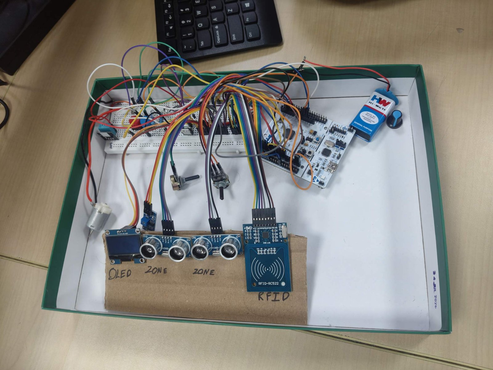
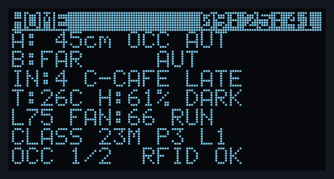
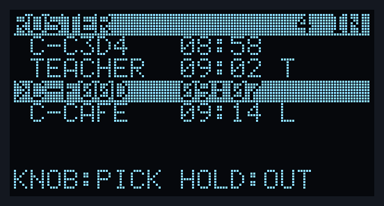
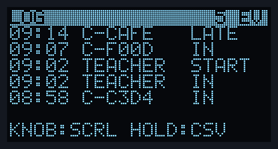
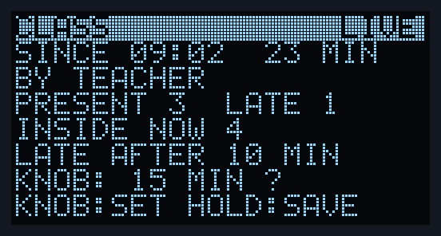
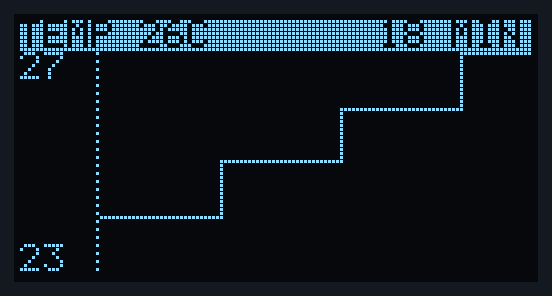
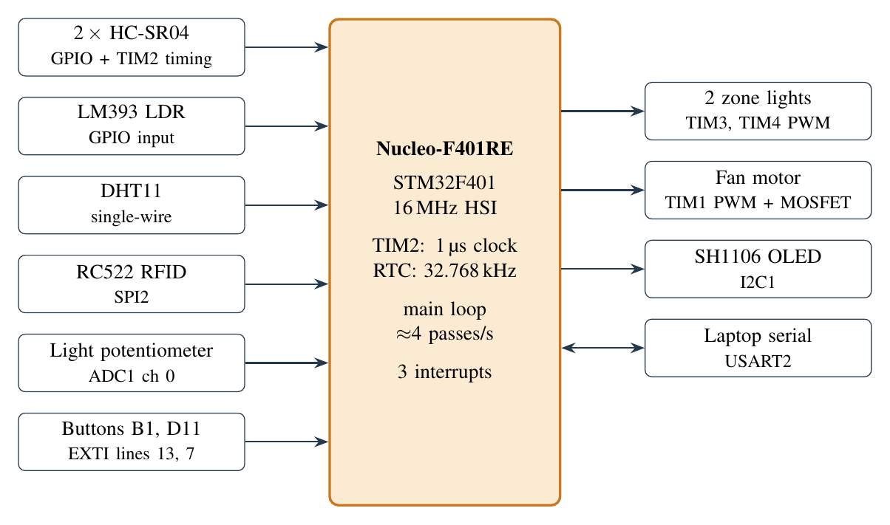

# Smart Classroom Automation System

[](https://github.com/modi0903/smart-classroom-stm32/actions/workflows/ci.yml)

Occupancy-based lighting, RFID attendance and fan control for a classroom, written in
bare-metal C on an **STM32 Nucleo-F401RE**. No HAL, no Arduino core: every peripheral is
configured through its registers.

Microprocessors Project Lab, MIT Manipal, 2026.



## What it does

- **Two occupancy zones.** An HC-SR04 per zone measures distance; a debounced state machine
  (5 s to occupy, 10 s to vacate) decides whether the zone is in use.
- **Zone lights.** PWM LEDs that turn on only when their zone is occupied **and** the room is
  dark (LM393 light sensor). A potentiometer sets the brightness.
- **RFID at the door.** An RC522 reader keeps a roster of who is inside. Each card tap toggles
  IN/OUT, with a 3 s lockout so a resting card counts once.
- **Teacher sessions.** The teacher's card starts and ends a class. Students arriving more than
  the late limit after the start are marked **LATE**; a summary is printed when the class ends.
- **Fan.** A DC motor through an IRLZ44N MOSFET, PWM at 20 kHz. It runs only while someone is
  tapped in, at a level (0/33/66/100) stepped with the board's blue button.
- **Five-screen OLED interface** driven by one button (tap = next screen, hold 2 s = select)
  and the light knob: HOME, ROSTER, LOG, CLASS, GRAPH.
- **Temperature, humidity and time.** DHT11 over a single wire, on-chip RTC on the 32.768 kHz
  crystal, settable over serial.

## The screens

| HOME | ROSTER | LOG |
|:---:|:---:|:---:|
|  |  |  |
| Live status; knob = brightness | Who is inside; hold = mark OUT | Last 32 events; hold = CSV to serial |

| CLASS | GRAPH |
|:---:|:---:|
|  |  |
| Running class; knob sets the late limit | Last 18 min of temp / humidity / people |

These are rendered on a PC from the firmware's own drawing code
([tools/oled-sim](tools/oled-sim)).

## Hardware at a glance



| Part | Connection |
|---|---|
| 2 × HC-SR04 | A: TRIG D2 (PA10), ECHO D3 (PB3) · B: TRIG D4 (PB5), ECHO D5 (PB4) · 5 V |
| Zone LEDs | D9 (PC7, TIM3_CH2), D10 (PB6, TIM4_CH1) |
| DHT11 | D8 (PA9) |
| LM393 light sensor | A3 (PB0), digital out |
| SH1106 OLED | I2C1: SCL D15 (PB8), SDA D14 (PB9) |
| RC522 RFID | SPI2: SCK PB13, MISO PB14, MOSI PB15, SS PB12, RST PC5 · **3.3 V only** |
| Light potentiometer | A0 (PA0, ADC1 ch0) |
| Menu button | D11 (PA7) to GND |
| Fan | D7 (PA8, TIM1_CH1) → 220 Ω → IRLZ44N gate; 9 V battery, 1N4007 flyback, common ground |

Full pin map, parts list and the motor driver schematic: [docs/hardware.md](docs/hardware.md).

## Build and flash

You need `arm-none-eabi-gcc`, CMake, Ninja and STM32CubeProgrammer (`STM32_Programmer_CLI`) on
your PATH.

```bat
cd firmware
cmake -B build -G Ninja -DCMAKE_TOOLCHAIN_FILE=cmake/gcc-arm-none-eabi.cmake
flash.bat
```

`flash.bat` builds and programs the board over SWD. No toolchain? Download
`nucleo_classroom.hex` from the [latest release](https://github.com/modi0903/smart-classroom-stm32/releases/latest)
and flash it with STM32CubeProgrammer.

Run the logic tests on any PC (no board needed):

```sh
gcc -Wall -Wextra -Ifirmware/Core/Inc firmware/tests/host_test.c -o host_test && ./host_test
# 551 checks, 0 failed
```

## Repository layout

```
firmware/            the exact project running on the board (v2.1)
  Core/Src/main.c      drivers, interrupts, screens, main loop
  Core/Inc/logic.h     roster, light and fan rules, date parsing (pure, host-tested)
  Core/Inc/extras.h    sessions, event log, knob helpers, fan levels, graphs (pure, host-tested)
  tests/host_test.c    551 checks
docs/                hardware, firmware internals, user guide, testing, project history
  reports/             lab report (v1) and final review slides (PDF)
tools/oled-sim/      runs main.c on a PC: renders the screens, tests the button logic
```

## Documentation

| Document | Covers |
|---|---|
| [User guide](docs/user-guide.md) | Buttons, the five screens, teacher sessions, serial commands |
| [Hardware](docs/hardware.md) | Pin map, parts and cost, wiring, the motor driver |
| [Firmware](docs/firmware.md) | Architecture, main loop, every driver (I2C, SPI/RC522, UART, ADC, PWM, RTC, DHT11), interrupts |
| [Testing](docs/testing.md) | Host tests, the PC simulator, the on-board checklist |
| [History](docs/history.md) | Bluepill → Blackpill → Nucleo, every version, problems and fixes |
| [Lab report (PDF)](docs/reports/lab-report-v1.pdf) | Formal report; describes the v1 build |
| [Final review slides (PDF)](docs/reports/final-review-slides.pdf) | 37 slides, v2.1 |

## Versions

| Tag | What changed |
|---|---|
| [`v1-final`](https://github.com/modi0903/smart-classroom-stm32/tree/v1-final) | Build described in the lab report: override button, fan potentiometer, single 8-line screen |
| [`v2`](https://github.com/modi0903/smart-classroom-stm32/tree/v2) | Five screens, teacher sessions, event log, graphs; lights follow the sensors only |
| [`v2.1`](https://github.com/modi0903/smart-classroom-stm32/tree/v2.1) | One menu button (tap/hold); blue button sets the fan level. **Running on the board** |

## Team

| Member | Part |
|---|---|
| Tanmay Modi ([@modi0903](https://github.com/modi0903)) | System, sensing, firmware integration, user interface |
| Tejaswi B Gowda ([@TBG06](https://github.com/TBG06)) | Motor driver and fan |
| Ayush | RFID integration |
| Tejas | DHT11 and RTC |

## License

MIT for the project code (see [LICENSE](LICENSE)). The CMSIS headers and ST's startup and
system files keep their original Apache-2.0 license headers.
