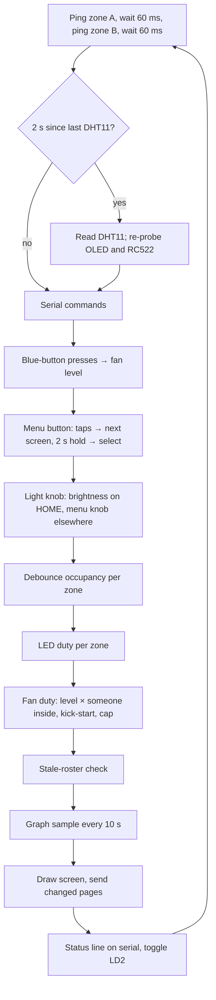
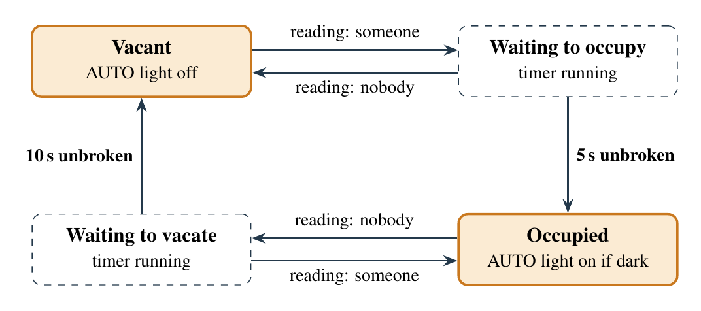
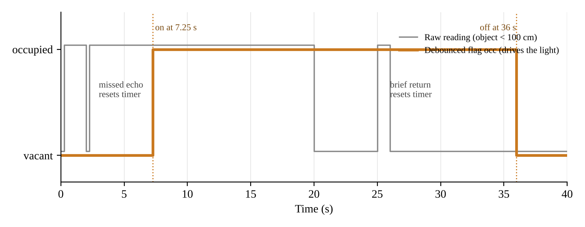
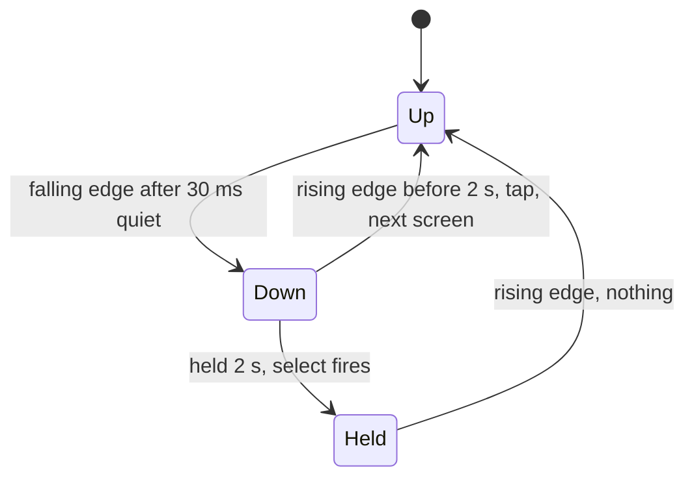

# Firmware

Bare-metal C on the STM32F401RE. The only vendor code is the CMSIS device header (register
names), ST's startup file and `SystemInit`. Every peripheral is configured by writing its
registers directly.

## Files

| File | Contents |
|---|---|
| `Core/Src/main.c` | Drivers, interrupt handlers, the five screens, the main loop |
| `Core/Inc/logic.h` | Pure logic: roster, light duty, fan rules, pot mapping, BCD/date parsing |
| `Core/Inc/extras.h` | Pure logic for v2: card names, sessions, event log, knob helpers, fan levels, graph history |
| `Core/Src/font_table.inc` | 5×7 font, 61 glyphs (space to Z, plus lowercase c and m for "cm") |
| `tests/host_test.c` | 551 checks of `logic.h` and `extras.h`, compiled with gcc on a PC |

The headers contain no register access, so they compile on a PC and are tested there. Time is
always passed in as an argument (microseconds from TIM2, or seconds since midnight from the
RTC), so tests can fake it.

`#define FEATURES 0` at the top of `main.c` builds the v1 screen and override behaviour.

## Clocks and time base

- **16 MHz HSI, no PLL.** Every timer and baud calculation starts from 16 MHz.
- **TIM2 is a free-running 1 µs counter**: PSC = 15 (16 MHz ÷ 16), ARR = 0xFFFFFFFF.
  `micros()` reads `TIM2->CNT`. All delays and timeouts compare `micros() - start`; with
  unsigned arithmetic this stays correct when the counter wraps every 71 minutes.

## Peripheral map

| Peripheral | Use | Setting |
|---|---|---|
| TIM2 | microsecond time base | 1 MHz, 32-bit |
| TIM3 CH2, TIM4 CH1 | zone A and B lights | PSC 15, ARR 999 → 1 kHz, duty 0–999 |
| TIM1 CH1 | fan MOSFET gate | PSC 0, ARR 799 → 20 kHz, MOE set |
| ADC1 ch0 | light knob | 144-cycle sampling, mean of 8 |
| SPI2 | RC522 | master, mode 0, ÷16 = 1 MHz, software NSS |
| I2C1 | SH1106 OLED | 100 kHz standard mode |
| USART2 | log and commands | 115200 8N1, RX interrupt |
| RTC | date and time | LSE 32.768 kHz (LSI fallback) |
| EXTI13 | blue button B1 | falling edge |
| EXTI7 | menu button D11 | both edges |

## Main loop

One pass takes about 0.25 s.



The RFID reader is polled inside every wait (`wait_poll`) and after every display page sent,
so a card tap is seen within tens of milliseconds even though the loop is slower.

Estimated time per pass: ≈125 ms of ultrasonic pings and gaps, up to ≈95 ms of OLED traffic
when every page changes (usually far less), and a few ms for the rest.

---

## Occupancy: HC-SR04 and the debounce

1. TRIG high for 10 µs.
2. Wait up to 5 ms for ECHO to rise, otherwise `NO ECHO` (usually wiring or power).
3. Time the ECHO pulse on TIM2. Longer than 25 ms → `FAR`.
4. Distance in cm = pulse µs ÷ 58 (sound covers the distance twice at ≈0.0343 cm/µs).
5. Under 100 cm (`OCC_CM`) counts as someone present.

The raw reading drives a per-zone state machine. A change of state needs the opposite reading
**without a break**: 5 s to become occupied (`OCC_MS`), 10 s to become vacant (`VACANT_MS`).
Any agreeing reading clears `pending_since` and the count restarts.




## Lights

- AUTO mode: duty = brightness if the zone is occupied **and** the LM393 output is HIGH (dark),
  otherwise 0. (OFF, DIM and MAX modes exist as compile-time options.)
- Brightness comes from the light knob: ADC 0–4095 → duty 50–999
  (`pot_brightness`). Changes smaller than 8 duty counts are ignored (a dead band), so ADC
  noise doesn't make the LEDs shimmer or the shown percentage flicker; the end points are
  always reachable exactly.
- PWM mode 1 with preload: the pin is high while `CNT < CCR`, so CCR = 750 means 75 % on.
- Off the HOME screen the knob drives the menus. When you return to HOME, the brightness is
  held (shown as `L75*`) until the knob reaches it again (`pickup_update`), so the lights
  never jump.

## DHT11 (single wire, PA9)

The pin is open drain with a pull-up, so the same pin can drive the line low and listen.

1. Pull low for 20 ms, release.
2. The sensor answers ≈80 µs low, ≈80 µs high.
3. 40 bits, each ≈50 µs low then high: 26–28 µs = 0, ≈70 µs = 1. Threshold 45 µs.
4. Byte 4 must equal the low 8 bits of bytes 0 + 1 + 2 + 3. Byte 0 is humidity, byte 2 is
   temperature.

Every edge has a 100 µs timeout, so a missing sensor costs a failed read, never a hang. Read
every 2 s; each read blocks ≈25 ms.

---

## I2C and the SH1106 OLED

**Bus.** SCL = PB8, SDA = PB9, alternate function 4, open drain with pull-ups. Devices only
ever pull a line low; the resistors make the high. START = SDA falls while SCL is high; STOP =
SDA rises while SCL is high; data changes only while SCL is low. After every byte the receiver
pulls SDA low for one clock (ACK).

**Init (`i2c_init`).**

- Bus clear first: 9 manual clocks on SCL, then a STOP. If a reset hit mid-transfer, the OLED
  may be holding SDA low waiting for clocks; 9 clocks let it finish and let go.
- Reset I2C1, then:
  - `CR2 = 16`: peripheral clock is 16 MHz
  - `CCR = 80`: SCL high and low each 80 × 62.5 ns = 5 µs → 100 kHz
  - `TRISE = 17`: 1000 ns max rise time ÷ 62.5 ns + 1
  - `CR1 = PE`: enable

**One write (`i2c_write(addr, ctrl, buf, len)`).**

1. Wait while `BUSY` (2 ms timeout; re-init the bus if stuck).
2. `START`, wait `SB`.
3. `DR = addr << 1` (write), wait `ADDR`. Clear `ADDR` by reading `SR1` then `SR2`.
4. For the control byte and each data byte: wait `TXE`, write `DR`.
5. Wait `BTF` (last byte fully sent), then `STOP`.
6. Any timeout or `AF` (NACK) clears `AF`, sends `STOP` and returns false. The display is then
   re-probed every 2 s; the loop never hangs on it.

**What the OLED receives.** The byte after the address is a control byte: `0x00` = commands
follow, `0x40` = pixel data follows.

- Probe: send `0xAE` (display off) to 0x3C, then 0x3D. Whichever ACKs is the display.
- Init: `AE` off · `D5 80` clock · `A8 3F` 64 rows · `D3 00` offset · `40` start line ·
  `AD 8B` charge pump on · `A1`, `C8` flip to match the module · `DA 12` COM pins · `81 CF`
  contrast · `D9 1F` precharge · `DB 40` VCOMH · `A4` show RAM · `A6` normal · `AF` on.
- Memory: 128 × 64 pixels = 8 pages of 8 rows. One byte = one column of 8 vertical pixels,
  LSB at the top. A page is 128 bytes, and a text row is one page.
- Writing page *p*: commands `0xB0 | p`, `0x02`, `0x10` (column 2, because the SH1106 has 132
  columns for a 128-pixel panel), then 128 data bytes.
- Cost: ≈130 bytes × 9 bits ≈ 11.7 ms per page at 100 kHz.

**Frame buffer (v2).**

- Each pass draws the whole screen into `fb[8][128]` in RAM: 5×7 text (6 px per character,
  21 per row), an inverted title row, graph pixels.
- `fb_flush()` compares each page with `fb_sent`, the copy of what was last sent, and sends
  only the pages that differ. Usually that is the clock row and one or two values.
- It polls the RFID reader after each page sent.

## SPI and the RC522

**Bus.** SPI2: SCK PB13, MISO PB14, MOSI PB15 (AF5), mode 0 (clock idles low, sample on the
rising edge), master, ÷16 = 1 MHz. Chip select is PB12 driven in software (`SSM`, `SSI` set).
SPI is full duplex: every byte sent clocks one byte back, so a read sends a dummy `0x00`.

`spi2_xfer(b)`: wait `TXE` → write `DR` → wait `RXNE` → read `DR`, each with a 1 ms timeout.

**Register access.** Address byte = `(reg << 1) & 0x7E`, with bit 7 set for a read.

```
write: CS low, [addr],        [value], CS high
read:  CS low, [addr | 0x80], [0x00],  CS high   (the second byte back is the value)
```

**Reader setup (`rc522_init`).**

1. RST low 2 ms, wait 50 ms, soft reset (`0x0F`).
2. `VersionReg` (0x37): 0x91/0x92 on a genuine chip; 0x00 or 0xFF means no reader.
3. Timer: `TModeReg = 0x80` (auto-start after transmit), `TPrescaler = 0xA9` →
   13.56 MHz / (2·169 + 1) = 40 kHz = 25 µs ticks, reload 320 → **8 ms**. No answer within
   8 ms means no card.
4. `TxASKReg = 0x40` (100 % ASK, required by ISO 14443-A), `ModeReg = 0x3D` (CRC preset
   0x6363), `TxControlReg |= 0x03` (antenna drivers on: the 13.56 MHz field).

**The card.**

- A card has no battery. The reader's field powers it, the reader speaks by modulating the
  field (ASK), and the card answers by load modulation.
- States: IDLE → (REQA) → READY → (SELECT) → ACTIVE → (HALT) → HALT.

**REQA.**

- "Request, type A", code `0x26`, sent as a 7-bit short frame (`BitFramingReg = 7`).
- An IDLE card answers with **ATQA**, 2 bytes (UID size, anticollision support).
- We never SELECT. A card left in READY falls back to IDLE on the next REQA without
  answering, then answers the one after. So a card resting on the reader is seen roughly every
  other poll.
- That is why the roster has a 3 s lockout that keeps refreshing while the card is seen.

**Anticollision.**

- Send `0x93 0x20`: SEL for cascade level 1, NVB = "2 bytes sent, send me the whole UID".
- The card returns UID0–UID3 and **BCC** = UID0 ⊕ UID1 ⊕ UID2 ⊕ UID3, checked by the
  firmware.
- UID0 = `0x88` is the cascade tag: a 7-byte UID, which would need level 2. Not supported;
  shown as `7B`.
- Two cards at once collide (`CollErr`) and the read is rejected.

**One exchange (`rc_transceive`).**

1. Idle; clear IRQs (`ComIrqReg = 0x7F`); flush FIFO (`FIFOLevelReg = 0x80`).
2. Load the bytes into `FIFODataReg`; set `BitFramingReg` = valid bits in the last byte.
3. `CommandReg = 0x0C` (Transceive), then `StartSend`.
4. Poll `ComIrqReg`: `0x30` (Rx or Idle) = answer; `0x01` (Timer) = no card.
5. Reject if `ErrorReg & 0x1B` (overflow, collision, parity, protocol).
6. `FIFOLevelReg` gives the byte count; read the FIFO. `ControlReg & 7` gives the valid bits
   in the last byte.

## UART (USART2)

- PA2 = TX, PA3 = RX (AF7). Wired on the Nucleo to the ST-LINK, which appears on the PC as a
  USB virtual COM port.
- 8N1: start bit, 8 data bits LSB first, stop bit. 10 bits per character.
- `BRR = 139`: USARTDIV = 16 MHz / (16 × 115200) = 8.68 → mantissa 8, fraction
  0.68 × 16 ≈ 11 → (8 << 4) | 11. Actual rate 115108 baud (0.08 % error).
- TX: wait `TXE`, write `DR` (blocking; messages are short).
- RX: `RXNEIE` raises `USART2_IRQHandler` per byte.
  - Reading `DR` clears `RXNE` and the overrun flag `ORE`.
  - The byte goes into a 64-byte ring buffer; if `(head + 1) % 64 == tail` it is dropped.
  - Only the ISR writes `head`; only the main loop writes `tail`. Both are `volatile`.
- `serial_service()` echoes characters, handles backspace and runs a command on Enter. The
  status log pauses for 5 s while someone is typing.

## Fan (TIM1)

```c
knob    = fan_level_drive(fan_level);              /* 0, 35, 68, 100 % */
fan_now = fan_cmd(ovr, rf_count() > 0, knob);      /* 0 if nobody is tapped in */
fan_set(fan_apply(&fan, fan_now, micros()));       /* 0.3 s kick, then CCR1 */
```

- TIM1 CH1 on PA8 (AF1): PSC 0, ARR 799 → 20 kHz, above hearing, so no motor whine.
- PWM mode 1 with preload, `CC1E`. TIM1 is an advanced timer: outputs stay off until
  `BDTR.MOE` is set.
- `fan_ccr(pct, 60)` = pct × 60 × 8 / 100, so 100 % → CCR1 480 of 800 → ≈5.4 V average from 9 V.
- Kick-start: when the command rises from 0, run at 100 % (of the cap) for 0.3 s, because
  a stopped motor may not start at 35 %.

| Level shown | Driven | CCR1 | Avg. motor voltage |
|---|---|---|---|
| 0 | 0 % | 0 | 0 V |
| 33 | 35 % | 168 | ≈1.9 V |
| 66 | 68 % | 326 | ≈3.7 V |
| 100 | 100 % | 480 | ≈5.4 V |

## RTC

- LSE 32.768 kHz ÷ 128 (`PREDIV_A` 127) = 256 Hz ÷ 256 (`PREDIV_S` 255) = 1 Hz. If the crystal
  doesn't start within 2.5 s, the LSI (~32 kHz, ÷128 ÷250) is used and the clock shows `LSI`.
- Writing it:
  1. `PWR_CR.DBP` (backup domain writable)
  2. `RTC_WPR` ← 0xCA, 0x53 (unlock)
  3. `INIT`, wait `INITF`
  4. write `PRER`, then `TR`/`DR` in BCD, 24 h
  5. clear `INIT`, lock, wait `RSF` before reading
- Keeping it: `BKP0R` holds an FNV-1a hash of `__DATE__`/`__TIME__`.
  - Same build after a reset: the clock keeps running.
  - New build or power loss: reset the backup domain and set the clock from the build time.
- `BKP1R` keeps the class late limit through a reset.
- VBAT is tied to VDD on the Nucleo, so unplugging USB loses both.

## Interrupts

| Handler | Source | Does |
|---|---|---|
| `EXTI15_10_IRQHandler` | B1 on PC13, line 13, falling edge | Clears `PR`; ignores edges within 250 ms; counts presses |
| `EXTI9_5_IRQHandler` | menu button PA7, line 7, both edges | Tap/hold tracking (below) |
| `USART2_IRQHandler` | RXNE | Ring buffer (above) |

Rule: handlers only record events; every decision happens in the main loop.

**Tap or hold on one button.**

- The ISR accepts an edge only after 30 ms of quiet on the line. Bounce arrives as a burst
  and is ignored; the quiet timer restarts on every edge.
- Pin low + not down → press: store the time.
- Pin high + down → release: count a tap, unless a hold already fired.
- `ui_button_poll()` runs each loop:
  - It fires the screen's action once the button has been held 2 s (`HOLD_US`), while still
    held. It marks `ui_long_done` so the release doesn't also count as a tap.
  - It shows `KEEP HOLDING...` from 0.4 s.
  - It re-syncs with the pin if the line has been quiet for 50 ms and the stored state
    disagrees. Interrupts are briefly disabled around this read-modify-write.



## Roster, sessions and the log

- **Roster** (`logic.h`): 8 slots of {uid, last seen, used, inside}.
  - A known card seen within 3 s is ignored, and its window restarts. Otherwise it flips
    IN ↔ OUT.
  - A new card takes a free slot, or the slot of the card that left longest ago; if all 8 are
    inside: `FULL`.
  - `in_sod[8]` stores each slot's tap-in time.
- **Stale reset**: cards IN but both zones vacant → roster cleared after 2 min (10 min during a
  class), counted from 30 s after the last tap-in.
- **Session** (`extras.h`): the teacher card starts it.
  - Everyone already inside is on time.
  - A student's first entry more than `late_min` minutes after the start is `LATE`; re-entry
    keeps the first mark. Up to 16 students.
  - The teacher's tap-out (or forced out, or a stale reset) ends it and prints a summary.
- **Event log**: ring of 32 {seconds since midnight, uid, type}. Types: IN, OUT, LATE, DENY,
  FULL, START, END, FORCE, RESET.
- **Graph history**: 108 one-byte samples per series, one per 10 s, gaps for failed reads.

## Memory

About 17 KB of flash (of 512 KB) and 6.2 KB of RAM (of 96 KB), 2 KB of which is the frame
buffer and its sent copy. No heap; everything is statically allocated.
