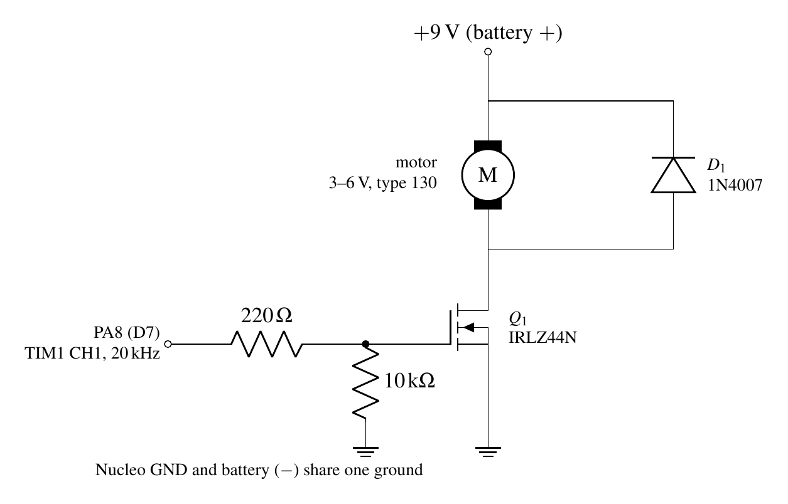

# Hardware

Everything runs from the Nucleo's USB, except the fan motor, which has its own 9 V battery.
**All grounds are common**, including the battery's negative terminal.

## Pin map

Arduino-header labels are given where the pin has one. PB12 to PB15 and PC5 are only on the ST
morpho headers (see the pin table in ST's UM1724).

| Part | Signal | Nucleo pin | Peripheral |
|---|---|---|---|
| Zone A HC-SR04 | TRIG / ECHO | D2 (PA10) / D3 (PB3) | GPIO, timed on TIM2 |
| Zone B HC-SR04 | TRIG / ECHO | D4 (PB5) / D5 (PB4) | GPIO, timed on TIM2 |
| Both HC-SR04 | VCC / GND | 5V / GND | ECHO pins are 5 V tolerant |
| Zone A LED | anode via 220–330 Ω | D9 (PC7) | TIM3_CH2, 1 kHz PWM |
| Zone B LED | anode via 220–330 Ω | D10 (PB6) | TIM4_CH1, 1 kHz PWM |
| DHT11 | DATA / VCC / GND | D8 (PA9) / 3V3 / GND | GPIO, open drain + pull-up |
| LM393 light module | DO / VCC / GND | A3 (PB0) / 3V3 / GND | GPIO input, HIGH = dark |
| SH1106 OLED 1.3" | SCL / SDA / VCC / GND | D15 (PB8) / D14 (PB9) / 3V3 / GND | I2C1, 100 kHz |
| RC522 RFID | SCK / MISO / MOSI | PB13 / PB14 / PB15 | SPI2, mode 0, 1 MHz |
| | SDA (SS) / RST | PB12 / PC5 | GPIO (software chip select) |
| | 3.3V / GND | **3V3 only** / GND | IRQ pin unused |
| Light potentiometer 10 kΩ | wiper / ends | A0 (PA0) / 3V3 and GND | ADC1 channel 0 |
| Menu button | one leg / other leg | D11 (PA7) / GND | EXTI line 7, internal pull-up |
| Blue button B1 | on the board | PC13 | EXTI line 13 |
| Fan gate | via 220 Ω, 10 kΩ to GND | D7 (PA8) | TIM1_CH1, 20 kHz PWM |
| RTC crystal | on the board | LSE 32.768 kHz | RTC |
| Serial | on the board | PA2 / PA3 | USART2 → ST-LINK virtual COM port |

The v1 build also read a fan potentiometer on A2 (PA4, ADC1 ch4). It failed during testing, and
v2.1 does not read A2.

## Block diagram

## Motor driver

| Part | Value | Why |
|---|---|---|
| Q1 | IRLZ44N | Logic-level N-MOSFET: gate threshold 1–2 V, so 3.3 V turns it on enough for a small motor |
| Low-side placement | MOSFET between motor and ground | Source sits at 0 V, so the 3.3 V pin sets VGS directly. A high-side N-channel would need a gate above 9 V |
| D1 | 1N4007 across the motor, cathode to +9 V | Gives the motor's inductive current a path when the MOSFET turns off, clamping the drain spike |
| Gate resistor | 220 Ω | Limits the pin current while the gate capacitance charges; damps ringing |
| Gate pull-down | 10 kΩ | Holds the gate low while the MCU is in reset, so the fan can't start on its own |
| Supply | 9 V battery | Motor current stays off the Nucleo's USB supply |
| Motor | type 130, 3–6 V | Firmware caps the duty at 60 %: 9 V × 0.6 ≈ 5.4 V average |

A Schottky diode would suit 20 kHz switching better than the slow-recovery 1N4007.

## Parts and cost

Prices are what we paid (INR). Parts without a price came from the lab or a kit.

| Part | Qty | Price (₹) |
|---|---|---|
| STM32 Nucleo-F401RE | 1 | 2579 |
| HC-SR04 ultrasonic sensor | 2 | 69 each |
| DHT11 temperature and humidity sensor | 1 | 51 |
| LED module | 1 | 51 |
| DC motor, type 130, 3–6 V | 1 | 45 |
| IRLZ44N MOSFET | 1 | 39 |
| 1N4007 diode | 1 | 12 |
| RC522 RFID reader with card and tag | 1 | – |
| SH1106 1.3" I2C OLED | 1 | – |
| LM393 light sensor module | 1 | – |
| 10 kΩ potentiometer | 1 (2 in v1) | – |
| Push button, resistors, breadboard, jumpers, 9 V battery | – | – |

## Wiring notes

- **RC522 is 3.3 V only.** 5 V damages it.
- **I2C pull-ups**: the OLED module carries its own; the firmware also enables the internal ones.
- **Menu button to GND**, not to 3V3. The pin relies on its internal pull-up.
- **Battery negative to Nucleo GND.** Without it the MOSFET gate has no reference.
- If the LDR module reads the wrong way round, change `is_dark()` in `main.c`.
