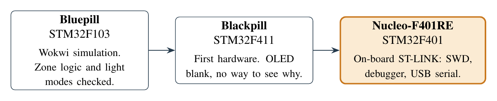

# Project history

## Platforms

1. **Bluepill (STM32F103) in Wokwi.** The zone logic and light modes were checked in
   simulation before any wiring.
2. **Blackpill (STM32F411).** First hardware. The OLED stayed blank and there was no debugger
   to find out why.
3. **Nucleo-F401RE.** The on-board ST-LINK gives SWD programming, debugging and a USB serial
   port in one cable.

An Arduino sketch was used only as a wiring check, so that later faults could be blamed on the
firmware rather than the breadboard. The register-level build replaced it: about 17 KB of flash
against about 42 KB for the Arduino build.

The original design had three zones and a 16×2 LCD. A wiring fault on the third ultrasonic
sensor never went away, so the final system has two zones. The SH1106 OLED replaced the LCD.

## Versions

| Date | Commit / tag | Added |
|---|---|---|
| 15 Oct 2026 | RFID at the door | RC522 over SPI2, IN/OUT roster with lockout, on top of the two zones, PWM lights, LDR, DHT11 and OLED |
| 18 Oct 2026 | Pot, RTC, interrupts | Light dimmer pot, on-chip RTC with serial time setting, blue-button override (EXTI), USART RX interrupt |
| 19 Oct 2026 | `v1-final` | Fan: IRLZ44N on TIM1 at 20 kHz, fan pot, RFID gating, kick-start. **The lab report describes this build** |
| 28 Oct 2026 | `v2` | Five screens, frame buffer, teacher sessions, LATE marking, event log, graphs. Lights stop following RFID taps |
| 28 Oct 2026 | `v2.1` | One menu button (tap/hold), blue button sets the fan level. **Running on the board** |

## Problems and what we did

| Problem | Cause | Resolution |
|---|---|---|
| OLED blank on the Blackpill | No debugger to inspect the board | Moved to the Nucleo |
| OpenOCD could not connect | ST-LINK firmware from 2019 | Flashed with `STM32_Programmer_CLI` over SWD |
| One zone LED would not light | Breadboard wiring; the fault moved with the pins | Rewired |
| Third ultrasonic sensor unreliable | Persistent wiring fault | Two zones |
| OLED froze on an old frame after the pot was added | Not confirmed | Pot removed, USB power cycled; display recovered |
| A tap lit both zones even with nobody in them | v1 "entry boost" treated a tap as occupancy for 30 s | v2: lights follow the zone sensors only |
| Fan potentiometer failed | Faulty part | v2.1: four fan levels on the blue button |
| No free pin near D6 for a second menu button | Crowded header | v2.1: one button, tap vs 2 s hold |

Most faults were wiring, not firmware. Checking every wire against the pin map, with the Arduino
build as a known-good reference, was the fastest diagnostic.

## Known limits

- RFID counts cards, not people, and relies on people tapping out; the stale reset limits the
  error.
- 4-byte UIDs only (7-byte cards show `7B`).
- Capacity: 8 cards in the roster, 16 students per class, 32 log events.
- Clock and late limit are lost on power-off (VBAT tied to VDD). A coin cell on VBAT fixes it.
- The 1N4007 is slow for 20 kHz switching; a Schottky diode would be better.
