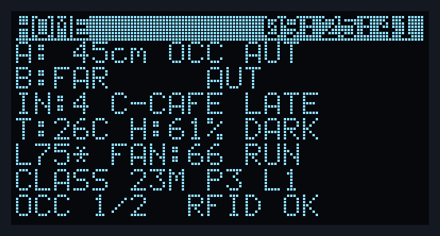
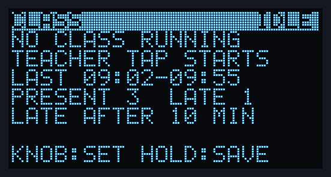

# User guide

## Controls

| Control | Does |
|---|---|
| **Menu button (D11), tap** | Next screen, on release: HOME → ROSTER → LOG → CLASS → GRAPH → HOME |
| **Menu button, hold 2 s** | The current screen's action. `KEEP HOLDING...` appears from 0.4 s; the action fires at 2 s while still held, and releasing afterwards does nothing |
| **Blue button B1** | Fan level 0 → 33 → 66 → 100 → 0, on any screen. Starts at 0 after a reset |
| **Light knob (A0)** | HOME: brightness. Other screens: pick a row, scroll, or set a value |
| **RFID card** | Tap to check in, tap again to check out |

## Screens

Row 0 is an inverted title bar. Row 7 says what the knob and a hold do on that screen, and shows
the result of a hold for 2.5 s.

### HOME


- Zone A and B distance, `OCC` when occupied, and the zone mode.
- Headcount, last card and what it did (IN, OUT, LATE, START, END…).
- Temperature, humidity, DARK/BRIGHT.
- Light %, fan level, `RUN` or `STOP` (STOP = nobody tapped in).
- Class time, present and late counts, or `NO CLASS`.
- Occupied zones and reader status.

After a menu, HOME shows `L75*` until the knob is turned back to the current brightness:



### ROSTER


Everyone inside, with tap-in time. `T` = teacher, `L` = late in the running class. Turn the knob
to highlight someone; **hold** to mark them OUT (for people who left without tapping). Marking the
teacher out ends the class.

### LOG


The last 32 events, newest first. The knob scrolls back. **Hold** prints the whole log on serial
as CSV.

### CLASS


While a class runs: start time, minutes, present, late, inside now. The knob proposes a late limit
of 0 to 30 minutes; **hold** saves it. Afterwards the screen keeps the last class's summary:



### GRAPH


The last 18 minutes, one point every 10 s, scaled to the data. Knob left = temperature,
middle = humidity, right = people inside. **Hold** freezes the plot (`HOLD`).

## Lights

A zone's light is on only when the zone is occupied **and** the room is dark. A zone becomes
occupied after 5 s of continuous detection within 1 m, and vacant after 10 s of continuous
absence. Card taps never switch lights.

## Fan

Runs at the chosen level only while at least one card is checked in. Starting from stop, it runs
at full allowed speed for 0.3 s first, then settles to the level. The level resets to 0 on every
reset, so press B1 once after power-up.

## Teacher sessions

Cards are named in `CARDS[]` near the top of `firmware/Core/Src/main.c`:

```c
static const card_t CARDS[] = {
  { 0x62E26506, "TEACHER", ROLE_TEACHER },
  /* { 0xAABBCCDD, "RAHUL", ROLE_STUDENT }, */
};
```

Unnamed cards appear as `C-` plus the last 4 hex digits of their UID. A card's UID is printed on
serial whenever it is tapped.

- The **teacher taps in**: a class starts. Everyone already inside is on time.
- A student's **first** tap-in more than the late limit after the start is **LATE**. Leaving and
  coming back keeps the first mark.
- The **teacher taps out**, is marked out, or the roster clears itself: the class ends and serial
  prints the summary.
- The late limit (default 10 min) survives a reset but not a power cut or reflash.
- Sessions only record attendance; lights and fan are unaffected.

Example summary:

```
[09:55:03] RFID 62E26506 TEACHER OUT  inside=3
[09:55:03] CLASS END  09:02-09:55  (53 min)  present=3 late=1
  C-C3D4  A1B2C3D4  first in 09:02  on time
  C-F00D  0BADF00D  first in 09:07  on time
  C-CAFE  7E57CAFE  first in 09:14  LATE
```

## Serial commands

Open the ST-LINK COM port at 115200 baud (PuTTY, Tera Term, the Arduino serial monitor). Type a
command and press Enter.

| Command | Does |
|---|---|
| `T 08:30` or `T 08:30:15` | Set the time |
| `D 28/10/26` | Set the date |
| `?` | Show date, time and clock source |
| `R` | Everyone inside: name, UID, time in, TEACHER/LATE |
| `L` | Event log as CSV |
| `S` | Running class and attendance, or the last class's summary |

The status line (one per loop pass) pauses for 5 s while you type.

The clock is lost when USB power is removed (VBAT is tied to VDD on the Nucleo). Set it with
`T` and `D` after powering up.

## Troubleshooting

| You see | Check |
|---|---|
| `NO ECHO` | HC-SR04 TRIG/ECHO wires, 5 V and GND |
| `FAR` | Sensor works; nothing within ~4 m |
| `DHT ERR` | D8 wire, 3V3 |
| Blank OLED | 3V3, GND, SCL/SDA. It is re-probed every 2 s, no reflash needed |
| `NO RFID` | 3V3 (never 5 V), GND, the four SPI wires (MISO/MOSI swapped is the usual mistake) |
| Menu button does nothing | D11 must go to **GND** through the button |
| Knob changes nothing | Only on HOME, and only visible while a zone light is on |
| Fan never starts | Level 0? Press B1. Nobody tapped in? `STOP` on HOME |
